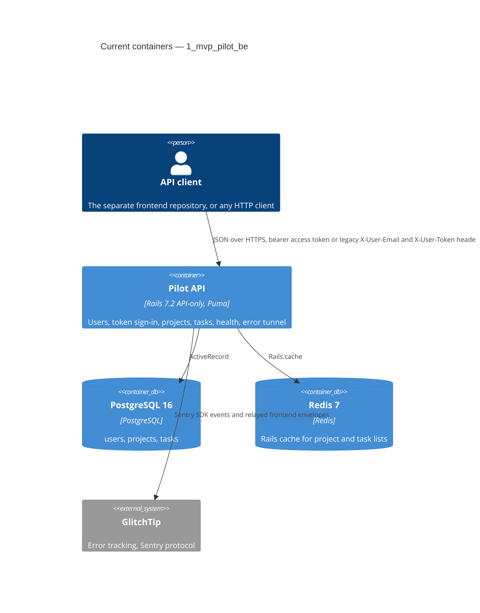

# Architecture map — 1_mvp_pilot_be

> The **current** architecture (what exists today), produced by `map-architecture` and read by
> write-prd / architecture-design / generate-data-model / implement-tasks. Refresh with
> `/sdlc-map-architecture` when the repo drifts past `reflects_commit`. This is generated; a
> hand-maintained `docs/architecture.md`, if present, is authoritative and reconciled below — not
> replaced.

## Stack

- Language / runtime: Ruby 3.3.6 (`.ruby-version`, `Dockerfile:3`)
- Frameworks: Rails 7.2, API only (`config/application.rb:30`, `ActionController::API` in
  `app/controllers/application_controller.rb:1`); Devise + `simple_token_authentication` (`app/models/user.rb:4`,
  `app/models/user.rb:7`); CanCanCan (`app/models/ability.rb:1`); active_model_serializers 0.10
  (`app/serializers/base_serializer.rb:1`); rswag (`spec/swagger_helper.rb:4`, contract
  `swagger/v1/swagger.json`); Sentry SDK reporting to GlitchTip (`config/initializers/sentry.rb:3`); rack-cors
  (`config/initializers/cors.rb`); Kamal 2 deploys (`config/deploy.dev.yml`, `config/deploy.yml`).
- Build / test / lint: `bundle exec rspec`, `bundle exec rubocop --parallel`, `bundle exec brakeman --no-pager -q`
  (each the exact `run:` of a CI step in `.github/workflows/rails-test.yml` / `rails-lint.yml`); also
  `bundle exec fasterer`, `bundle exec bundler-audit check --update`, gitleaks and actionlint in CI. No build step
  besides the Docker image built by Dev Deploy.

## C4 — system as it is

## Module inventory

| Module | Path | Layers | Wired at | Responsibility |
|---|---|---|---|---|
| users | `app/controllers/api/v1/users_controller.rb`, `app/services/users/` | controller → service → model | `config/routes.rb:12`, `config/routes.rb:14` | Sign-up (returns the access token) and `me` (the signed-in user's profile). |
| sessions | `app/controllers/api/v1/sessions_controller.rb`, `app/services/sessions/create.rb` | controller → service → model | `config/routes.rb:13` | Token sign-in: email and password in, the user's access token out. |
| projects | `app/controllers/api/v1/projects_controller.rb`, `app/services/projects/` | controller → service → model → serializer | `config/routes.rb:15` | CRUD of the signed-in user's projects, list filtered by task status, cached. |
| tasks | `app/controllers/api/v1/tasks_controller.rb`, `app/services/tasks/` | controller → service → model → serializer | `config/routes.rb:16` | CRUD of the tasks of one of the user's projects, cached list. |
| api/v1 | `app/controllers/api/v1/base_controller.rb`, `app/controllers/concerns/`, `app/exceptions/api_exceptions.rb`, `app/models/ability.rb`, `app/serializers/`, `app/services/application_service.rb`, `app/services/base_application/authenticate.rb`, `app/services/auth/legacy_usage.rb` | shared | `config/routes.rb:10` | Token authentication before every action, authorization, exception rendering, serializers and the service base class. |
| health | `app/controllers/health_controller.rb` | controller | `config/routes.rb:2` | `GET /health`: `status` and the `release` baked into the image (`APP_RELEASE`). |
| errors tunnel | `app/controllers/errors_controller.rb`, `app/services/sentry_tunnel.rb` | controller → service | `config/routes.rb:3` | `POST /api/errors`: relays the frontend's Sentry envelopes to GlitchTip, only for the allowed DSN, size and rate limited. |
| admin GlitchTip smoke | `app/controllers/admin/glitchtip_smoke_controller.rb`, `app/services/glitchtip_smoke.rb`, `lib/tasks/glitchtip.rake` | controller → service | `config/routes.rb:4` | Deliberate errors behind `SMOKE_TOKEN` that prove a deployment reports to GlitchTip; every refusal is a 404. |
| API docs | `swagger/v1/swagger.json`, `spec/swagger_helper.rb` | generated contract | `config/routes.rb:6`, `config/routes.rb:7` | rswag UI and the JSON contract at `/api-docs`. |
| deploy and CI tooling | `deploy/`, `bin/`, `.github/workflows/`, `.kamal/`, `config/deploy*.yml`, `config/project.env` | shell + workflows | `.github/workflows/dev-deploy.yml:11` | Dev Deploy (build once to ECR, Kamal over the VPN), prod promote and deploy, Kamal manage, CI, TDD check, main-guard, `bin/wait-dev-deploy`. |

## Conventions (cited — the rules a new feature must match)

- **Module wiring / registration:** a resource is a route under `namespace :api` / `namespace :v1`
  (`config/routes.rb:10`) and a controller inheriting `Api::V1::BaseController`
  (`app/controllers/api/v1/projects_controller.rb:1`) with `include Authorization` and CanCanCan
  `load_and_authorize_resource through: :current_user`, so a project is looked up among the signed-in user's own
  (`app/controllers/api/v1/projects_controller.rb:4`); nested tasks load the project the same way and the task
  through it (`app/controllers/api/v1/tasks_controller.rb:4`, `app/controllers/api/v1/tasks_controller.rb:5`).
- **Controller → service → serializer:** the action calls `<Resource>::<Action>.call(...)`
  (`app/controllers/api/v1/projects_controller.rb:27`); the service subclasses `ApplicationService`
  (`app/services/application_service.rb:2`), returns `self` and exposes `success?`, `errors` and `status_error`
  (`app/services/projects/create.rb:24`); the controller renders `{ data: SerializableResource }`
  (`app/controllers/api/v1/projects_controller.rb:30`) or `{ errors: [...] }` with `status_error`
  (`app/controllers/api/v1/projects_controller.rb:36`). Users and sessions render inline hashes instead
  (`app/controllers/api/v1/sessions_controller.rb:8`).
- **Error handling:** `ApiExceptionHandler` maps `ApiExceptions::*` to 403/404
  (`app/controllers/concerns/api_exception_handler.rb:5`, `app/exceptions/api_exceptions.rb:6`); `Authorization`
  maps `ActiveRecord::RecordNotFound` to 404 `{ error: 'Not Found' }`, which is also the answer for another user's
  project or task (`app/controllers/concerns/authorization.rb:5`, ADR-0007), and `CanCan::AccessDenied` to 403
  (`app/controllers/concerns/authorization.rb:6`); a missing or wrong token is
  401 `{ error: 'Not Authorized' }` (`app/controllers/api/v1/base_controller.rb:18`); validation errors are 422
  with `full_messages` (`app/services/projects/create.rb:18`).
- **Authentication:** a `before_action` on every API controller (`app/controllers/api/v1/base_controller.rb:4`):
  an `Authorization: Bearer` access token decides alone (`app/controllers/api/v1/base_controller.rb:16`); only a
  request without one falls back to the legacy `X-User-Email` + `X-User-Token` headers compared with
  `Devise.secure_compare` (`app/services/base_application/authenticate.rb:18`), counted per user and day and
  switched off by `LEGACY_AUTH_ENABLED=false` (`app/services/auth/legacy_usage.rb:1`, ADR-0005); sign-up and
  sign-in skip it (`app/controllers/api/v1/sessions_controller.rb:2`).
- **Authorization:** the owner-scoped lookup above comes first; one `Ability` is the second line: a user manages
  only their projects and the tasks of those projects (`app/models/ability.rb:7`, `app/models/ability.rb:8`).
- **IDs:** integer (bigint) primary keys, Rails defaults; foreign keys `user_id` / `project_id` with
  `add_foreign_key` (`db/schema.rb:22`, `db/schema.rb:52`).
- **Persistence / DB access:** ActiveRecord through the user's associations (`app/services/projects/index.rb:40`),
  eager loading with `includes` (`app/services/projects/index.rb:32`), counter caches (`app/models/project.rb:7`),
  list results cached in `Rails.cache` with a key built from count and latest `updated_at`
  (`app/services/projects/index.rb:26`, `app/services/tasks/index.rb:28`).
- **Migrations:** `db/migrate/<timestamp>_<name>.rb`, `ActiveRecord::Migration[7.2]`, `change` with `t.references
  ... foreign_key: true` and `t.timestamps` (`db/migrate/20250313163641_create_tasks.rb:1`); the schema of record
  is `db/schema.rb` (`db/schema.rb:13`). Existing migrations are append-only (CLAUDE.md Hard Rules).
- **Tests:** RSpec with FactoryBot (`spec/factories/projects.rb`) and shoulda-matchers
  (`spec/models/project_spec.rb:5`); service specs (`spec/services/projects/create_spec.rb:1`); controller specs
  (`spec/controllers/api/v1/projects_controller_spec.rb`); rswag request specs that generate the contract
  (`spec/requests/api/v1/projects_spec.rb:4`) with response schemas in `spec/schemas/`
  (`spec/schemas/projects.rb:3`) and auth helpers (`spec/support/auth_helper.rb:11`); shell tooling specs with PATH
  shims (`spec/support/deploy_sandbox.rb:8`).
- **Inter-module communication:** direct method calls inside one process; no events, jobs or queues in use
  (`app/jobs/application_job.rb` is the empty Rails default).
- **UI / styling:** N/A — API-only (see §Frontend / UI foundation).

## Datastores

| Store | Engine | Accessed via | Notes |
|---|---|---|---|
| Primary database | PostgreSQL 16 (`config/deploy.dev.yml:77`, CI `postgres:16-alpine`) | ActiveRecord (`config/database.yml`) | Tables `users`, `projects`, `tasks` (`db/schema.rb:17`, `db/schema.rb:27`, `db/schema.rb:37`). |
| Cache | Redis 7 (`config/deploy.dev.yml:88`) | `Rails.cache` `:redis_cache_store` (`config/environments/production.rb:64`) | Cached project and task lists, 15 minutes (`app/services/projects/index.rb:5`); a global `$redis` client also exists (`config/initializers/redis.rb:4`). |

## Frontend / UI foundation

N/A — API-only: this repository has no frontend; the frontend is a separate repository that calls this API.

## Where things live / closest precedents

- A new resource → like `projects`: a route (`config/routes.rb:15`), a controller under `app/controllers/api/v1/`
  (`app/controllers/api/v1/projects_controller.rb:1`), one service per action under `app/services/<resource>/`
  (`app/services/projects/create.rb:2`), a serializer (`app/serializers/project_serializer.rb:1`), an `Ability` rule
  (`app/models/ability.rb:7`), model, service, controller and rswag request specs, a schema in `spec/schemas/`, and
  the regenerated `swagger/v1/swagger.json`.
- A nested resource → like `tasks` under `projects` (`config/routes.rb:16`,
  `app/controllers/api/v1/tasks_controller.rb:4`).
- A public, unauthenticated endpoint → like `health` (`app/controllers/health_controller.rb:1`): inherits
  `ApplicationController`, not `Api::V1::BaseController`.
- A new screen / UI component → not in this repository (§Frontend / UI foundation).

## Constraints & known tech-debt

- `TASK_DEFINITION.md` (the original assignment) names fields and statuses that differ from the code: `title`
  vs `name`, and `new` vs the code's `not_started` / `in_progress` / `completed` (`app/models/task.rb:4`). The code
  and `swagger/v1/swagger.json` are authoritative.
- `ApplicationController#authenticate_user!` is an empty override of Devise's helper
  (`app/controllers/application_controller.rb:4`); real authentication happens only in `Api::V1::BaseController`.
  A controller that does not inherit it is public.
- `devise_for :users` mounts Devise's default routes next to the token API (`config/routes.rb:8`); which of them are
  usable in API-only mode is UNKNOWN (no spec covers them).
- A project with tasks cannot be deleted (`app/validators/project_deletion_validator.rb:3`,
  `app/models/project.rb:8`); deleting a user deletes their projects (`app/models/user.rb:9`).
- Task status is a string enum; a value outside the enum raises `ArgumentError`, which the service turns into an
  error (`app/services/tasks/create.rb:21`).
- Dev Deploy runs on `workflow_run` of Rails Tests and Rails CI (`.github/workflows/dev-deploy.yml:12`) for
  `develop` and `hotfix/*` only (GitHub sometimes creates only one of the two runs, so such a push is not always
  deployed). A merge into `main` is never deployed automatically: `bin/wait-dev-deploy` always dispatches Dev
  Deploy once for it.
- The kamal-proxy on the dev host is shared with another deployment: never `kamal remove` or `kamal proxy *` with
  `config/deploy.dev.yml` (`config/deploy.dev.yml:8`). Kamal versions are `sha-<sha>` on dev and `prod-sha-<sha>` on
  prod, while Kamal's default version is the bare git sha: a manual `kamal app start` needs `--version`.
- Public repository: no internal hostnames, IP addresses or account ids anywhere; the project name and zone come
  from `config/project.env`.

## Reconciliation with the authored architecture doc

No authored architecture doc; `README.md` and `CLAUDE.md` were read. This map is the current reference.
