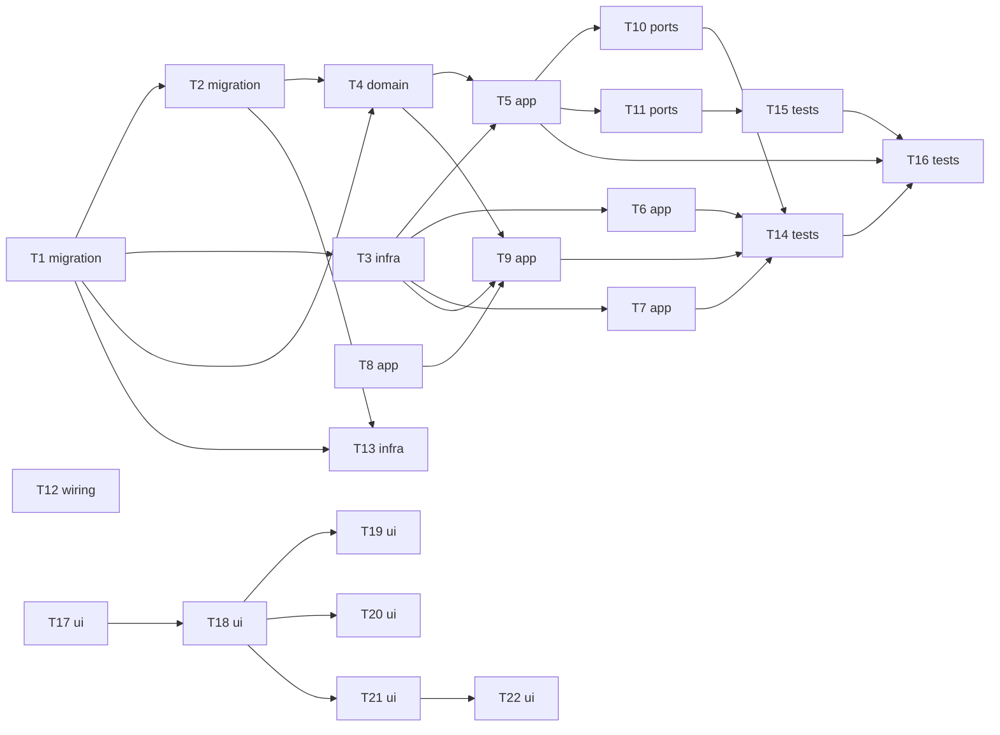

# Epic — todolist

> **PRD:** [PRD.md](../PRD.md) · **Design:** [sad.md](../sad.md) · **Data model:** [data-model.md](../data-model.md) · **API:** [openapi.yaml](../contracts/openapi.yaml) · **ADRs:** [adr/](../adr/)

## Goal

Open the project and task API to the public: a visitor signs up with Google sign-in or with email and password, every
sign-in gives the device its own revocable access token, and a guided dashboard leads the user to a first completed
task (PRD §2). The legacy access token keeps working until an evidence-based cutoff.

## Scope

- **In:** token model and Doorkeeper, dual-scheme authentication, Google sign-in and linking, sign-out, owner-scoped
  lookups, rate limits, purge job, contract and smoke-check updates (this repository, T1–T16); landing, sign-in,
  sign-up and dashboard screens (`1_mvp_pilot_fe`, T17–T22).
- **Out (PRD §3):** sharing, reminders and due dates, providers other than Google, signing out other devices, email
  confirmation, password reset by email, per-project progress counts, a native mobile app.
- **After the cutoff (not in this epic):** promote migrations 05 and 06 and delete the legacy access token code once
  the smoke script and contract use access tokens and no real legacy use was seen for 7 days
  ([ADR-0005](../adr/0005-accept-legacy-headers-alongside-bearer-until-evidence-cutoff.md)). Turn `LEGACY_AUTH_ENABLED`
  off first. Track it as its own small feature.

## Effort

Backend about 9.75 person-days against the PRD's roughly 2 weeks (10 working days): fits, with no slack. Frontend
about 5 person-days in `1_mvp_pilot_fe`. PRD §8 "does the scope fit two weeks" is answered by this estimate.

## Task map

Parallel starts: T1, T8, T12 and T17. The migration lane is T1 then T2. T5, T10 and T11 share the base controller and run
in that order; T3, T7 and T9 share `config/initializers/doorkeeper.rb` and run in that order. Frontend tasks need the
regenerated contract (sync-spec) but are tested against a stubbed `fetch`, so they start without the backend merged.

## Tasks

See [tracker.md](./tracker.md) for status. Machine contract: [tasks.json](./tasks.json).

| # | Task | Layer | Blocked by | First DoD item |
|---|---|---|---|---|
| T1 | [Promote the staged oauth_applications and oauth_access_tokens migrations](./t1-oauth-tables-migration.md) | migration | — | A migration spec shows both tables exist with the unique indexes on `uid`, `token` and `refresh_token` and the two foreign keys |
| T2 | [Promote the staged identities and legacy_token_uses migrations](./t2-identities-and-legacy-use-migration.md) | migration | T1 | A migration spec shows `identities` has unique `(provider, uid)` and unique `(user_id, provider)`, and `legacy_token_uses` has unique `(user_id, used_on)` |
| T3 | [Install Doorkeeper with the password grant, one-hour tokens and refresh rotation](./t3-doorkeeper-install.md) | infra | T1 | A correct email and password at `/oauth/token` returns an access and a refresh token and leaves other devices' tokens valid (AC-08) |
| T4 | [Add the user associations, Identity and LegacyTokenUse models and the Google-user password rule](./t4-token-and-identity-models.md) | domain | T1, T2 | Model specs cover the associations, the uniqueness validations and `dependent` behaviour |
| T5 | [Authenticate with a bearer token first, fall back to the legacy headers and count their use](./t5-dual-scheme-authentication.md) | app | T3, T4 | A valid bearer token and a valid legacy pair both give the same access to the user's own data (AC-12) |
| T6 | [Sign-up issues a token pair and enforces the sign-up limit](./t6-sign-up-issues-tokens.md) | app | T3 | Valid sign-up returns the three new fields and the legacy token (AC-02) |
| T7 | [Count failed sign-ins per source and refuse above ten a minute before the password is checked](./t7-failed-sign-in-limit.md) | app | T3 | The 11th failed sign-in within a minute from one source is refused without checking the password and with a Retry-After header (AC-10) |
| T8 | [Verify a Google ID token: signature, audience, issuer, expiry and verified email](./t8-google-id-token-verifier.md) | app | — | A token with a valid signature, our audience, Google's issuer, a future expiry and a verified email returns the email and account id |
| T9 | [Add the google_id_token grant that creates a user or links Google and cancels all existing access](./t9-google-sign-in-grant.md) | app | T3, T4, T8 | An unknown verified email creates a user with an identity and returns a token pair (AC-05) |
| T10 | [Add POST /api/v1/sign_out for both authentication schemes](./t10-sign-out-endpoint.md) | ports | T5 | After sign-out on device A its tokens are refused while device B still works (AC-11) |
| T11 | [Scope project and task lookups to the owner so other users' items are not found](./t11-owner-scoped-lookups.md) | ports | T5 | Showing, updating or deleting another user's project or task gives the same answer as a missing one, for projects and tasks alike (AC-17) |
| T12 | [Allow the Authorization header in CORS and read GOOGLE_CLIENT_ID from the environment](./t12-cors-and-google-config.md) | wiring | — | A CORS preflight with `Authorization` is allowed for the configured origins |
| T13 | [Add the daily token and legacy-use purge and its Kamal cron role](./t13-token-purge-job.md) | infra | T1, T2 | A task spec shows old revoked and expired rows are deleted and recent or active rows are kept |
| T14 | [Document the sign-up, token, sign-in, sign-out and profile operations in the rswag specs and regenerate swagger.json](./t14-contract-specs-auth-operations.md) | tests | T6, T7, T9, T10 | Each operation has specs for every response listed in openapi.yaml (200/201/204, 400, 401, 422, 429) |
| T15 | [Run the project and task rswag specs under bearer auth and document the 404 answers](./t15-contract-specs-projects-tasks.md) | tests | T11 | Project create and rename, length limits and delete-with-tasks behave as AC-14, AC-15 and AC-16 say |
| T16 | [Make bin/swagger_smoke check the contract with a bearer token and keep a marked legacy pass](./t16-swagger-smoke-bearer-pass.md) | tests | T5, T14, T15 | The bearer pass checks sign-up, `me`, project and task create, read, update and delete, and sign-out |
| T17 | [Add client-side routing, the first shared CSS tokens and the landing page](./t17-frontend-router-tokens-landing.md) | ui | — | The landing route renders the explanation and both start options and no project data (AC-01) |
| T18 | [Add the API client, the token store with refresh, the Content-Security-Policy and GOOGLE_CLIENT_ID config](./t18-frontend-api-client-and-token-store.md) | ui | T17 | An expired access token is refreshed once and the request repeated without losing the caller's input |
| T19 | [Build the sign-up and sign-in screens](./t19-frontend-sign-up-and-sign-in.md) | ui | T18 | Valid sign-up and sign-in store the token pair and open the dashboard (AC-02, AC-08) |
| T20 | [Add the Google sign-in button and exchange the ID token](./t20-frontend-google-sign-in.md) | ui | T18 | A successful exchange stores the pair and opens the dashboard with the user's existing projects (AC-05, AC-06) |
| T21 | [Build the dashboard with the project list, status filter and project create, rename and delete](./t21-frontend-dashboard-projects.md) | ui | T18 | A signed-out visitor opening the dashboard is sent to sign-in and sees no data (AC-22) |
| T22 | [Add task create and status change, the guided empty state and sign-out](./t22-frontend-tasks-empty-state-sign-out.md) | ui | T21 | A new task appears as not started and each status change takes one action (AC-18) |

## Risks / Hard rules

- Authentication code changes only with an ADR and a regression test: T3, T5, T7, T9, T10 (ADR-0003 to ADR-0005 exist).
- A contract status change needs an ADR: the 404 answer is ADR-0007 (T11, T15).
- Migrations: only 01–04 are promoted in this epic; 05–06 wait for the cutoff. Never edit an existing file in
  `db/migrate/`, never hand-edit `db/schema.rb` or `swagger/v1/swagger.json`.
- New gems (Doorkeeper, the Google verifier dependency) and the frontend router need a reason in their PR descriptions.
- Never run `kamal remove` or `kamal proxy *` with `config/deploy.dev.yml`.
- No secrets or internal hostnames: the Google client id is public configuration from the environment.
